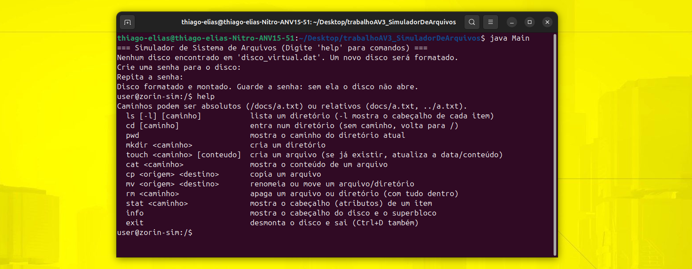
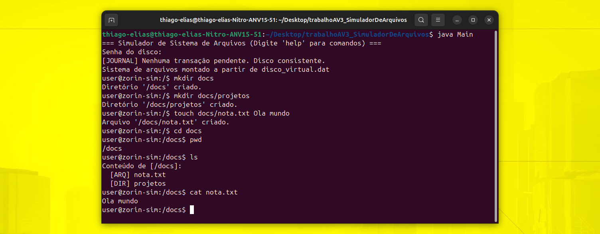
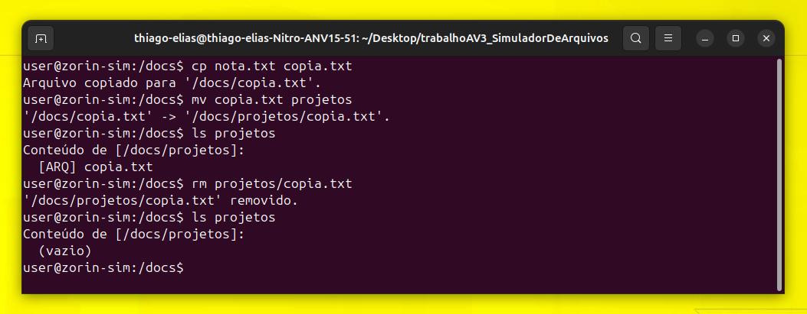
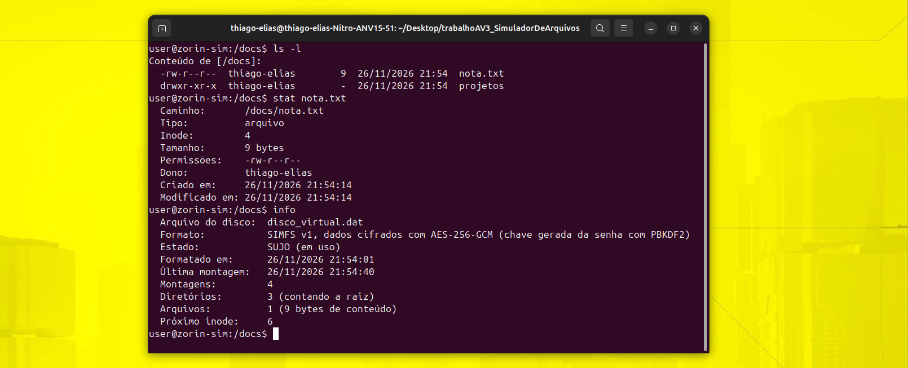
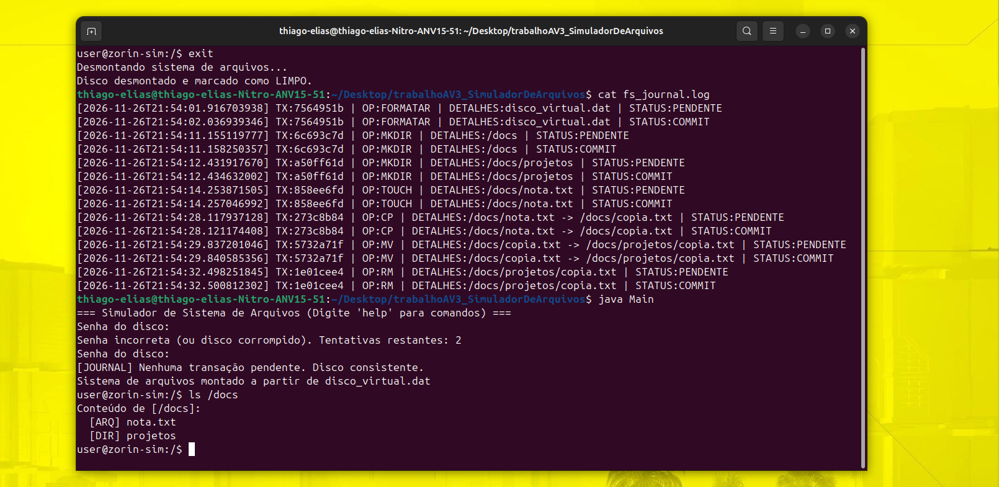

# Simulador de Sistema de Arquivos – AV3

## Identificação do trabalho

- **Título:** Simulador de Sistema de Arquivos – AV3
- **Disciplina:** Sistemas Operacionais
- **Integrante 1:** Maria Emanuelle - 2410404
- **Integrante 2:** Thiago Elias - 2315706

## 1. Introdução

Este trabalho apresenta um simulador de sistema de arquivos desenvolvido em Java para a avaliação AV3 da disciplina de Sistemas Operacionais. O programa funciona como um shell interativo, no estilo do terminal Linux, que permite criar, listar, copiar, mover e remover arquivos e diretórios dentro de um disco virtual armazenado em um único arquivo do computador.

A proposta é reproduzir, de forma didática, conceitos centrais do gerenciamento de arquivos: estrutura hierárquica de diretórios, cabeçalho de arquivo equivalente ao inode, superbloco, montagem e desmontagem do volume, journaling (registro prévio das operações) e recuperação após falhas. O simulador também protege o disco com senha e criptografia.

## 2. Funcionamento do sistema

### 2.1 Visão geral

O sistema mantém a árvore de arquivos e diretórios na memória e, a cada operação que altera o disco, grava o disco virtual por completo no arquivo `disco_virtual.dat`, seguindo o protocolo de journaling descrito na seção 2.5. As operações são registradas em texto legível no arquivo `fs_journal.log`. Consultas como `ls`, `cat`, `stat` e `info` apenas leem a memória e não alteram o disco.

### 2.2 Inicialização

1. A classe `Main` cria o `SistemaArquivos` com os arquivos `disco_virtual.dat` (disco) e `fs_journal.log` (journal).
2. Se o disco não existe, ele é formatado: o simulador pede uma senha não vazia e sua confirmação (até três tentativas), cria o diretório raiz `/` e o superbloco e grava o disco.
3. Se o disco existe, o simulador confere o cabeçalho visível (número mágico `SIMFS` e versão) e pede a senha, também em até três tentativas. A senha gera a chave de criptografia; se estiver errada, nada é alterado.
4. Na montagem, o sistema avisa se a sessão anterior terminou de forma anormal (estado SUJO), executa a recuperação do journal, registra a montagem e mantém o disco como SUJO enquanto estiver em uso.
5. O prompt `user@zorin-sim:<diretório>$` é exibido. Ao digitar `exit` (ou Ctrl+D), o disco é desmontado e marcado como LIMPO.

### 2.3 Principais funcionalidades

- Navegação com caminhos absolutos e relativos, incluindo `.` e `..`.
- Criação, leitura, cópia, movimentação/renomeação e remoção de arquivos e diretórios.
- Cabeçalho em cada item com inode, tipo, tamanho, datas de criação e modificação, dono e permissões no formato Linux.
- Superbloco com data de formatação, última montagem, número de montagens, próximo inode e última transação.
- Journaling com os status PENDENTE, COMMIT e ABORTADA e recuperação a cada montagem.
- Gravação atômica do disco (arquivo temporário seguido de substituição).
- Criptografia AES-256-GCM com chave derivada da senha por PBKDF2.
- Validação de nomes (não vazio, diferente de `.` e `..`, até 255 bytes, sem caracteres de controle).

### 2.4 Comandos disponíveis

| Comando | Finalidade |
|---|---|
| `ls [-l] [caminho]` | Lista um diretório; `-l` mostra permissões, dono, tamanho e data de modificação. |
| `cd [caminho]` | Muda o diretório atual; sem argumento, volta para `/`. |
| `pwd` | Mostra o caminho do diretório atual. |
| `mkdir <caminho>` | Cria um diretório. |
| `touch <caminho> [conteudo]` | Cria um arquivo com conteúdo opcional; se já existe, atualiza a data ou substitui o conteúdo. |
| `cat <caminho>` | Exibe o conteúdo de um arquivo. |
| `cp <origem> <destino>` | Copia um arquivo (diretórios não são copiados). |
| `mv <origem> <destino>` | Renomeia ou move um arquivo ou diretório. |
| `rm <caminho>` | Remove um arquivo ou um diretório com todo o seu conteúdo. |
| `stat <caminho>` | Mostra os atributos do cabeçalho de um item. |
| `info` | Mostra o estado do disco e as informações do superbloco. |
| `help` | Lista os comandos disponíveis. |
| `exit` | Desmonta o disco e encerra o simulador (Ctrl+D também). |

### 2.5 Simulação do gerenciamento de arquivos e diretórios

O código é organizado nas classes abaixo, que representam os elementos de um sistema de arquivos.

| Classe | Papel |
|---|---|
| `Main` | Shell: pede a senha, monta o disco e lê os comandos. |
| `SistemaArquivos` | Implementa os comandos, a resolução de caminhos e o journaling. |
| `NoSistema` | Classe abstrata de arquivo e diretório: nome, pai, cabeçalho e caminho calculado. |
| `ArquivoVirtual` | Arquivo comum; guarda o conteúdo e o tamanho em bytes (UTF-8). |
| `DiretorioVirtual` | Diretório; tabela (`TreeMap`) que liga cada nome ao item filho, em ordem alfabética. |
| `CabecalhoArquivo` | Atributos do item; equivale ao inode. |
| `Superbloco` | Informações gerais do disco e referência ao diretório raiz. |
| `DiscoVirtual` | Arquivo do disco: formato, criptografia, gravação atômica e leitura. |
| `JournalManager` | Escreve o journal e executa a recuperação. |

- Os itens formam uma árvore: o diretório guarda os nomes dos filhos e cada item guarda o seu cabeçalho. O caminho completo não é armazenado; é calculado subindo pelos pais até a raiz, de modo que mover uma pasta não exige atualizar o que está dentro dela.
- `cp` cria um novo item com novo inode e novas datas; `mv` altera o nome e o pai do item; `rm` retira o item da árvore.
- O sistema impede apagar ou mover a raiz, mover um diretório para dentro de si mesmo e apagar o diretório em que o usuário está.

**Journaling (write-ahead logging).** Cada operação que altera o disco segue quatro passos:

1. grava a linha PENDENTE no journal, antes de qualquer alteração;
2. aplica a alteração na árvore em memória;
3. anota o ID da transação no superbloco e grava o disco de forma atômica;
4. grava a linha COMMIT no journal.

Se a gravação falhar, a transação é registrada como ABORTADA e o disco é recarregado. Na montagem, uma transação que ficou apenas PENDENTE é completada com COMMIT quando seu ID é o da última transação gravada no superbloco; caso contrário, é marcada como ABORTADA. O conteúdo dos arquivos nunca é escrito no journal.

### 2.6 Tecnologias utilizadas

- **Java**, somente com a biblioteca padrão: `java.io`, `java.nio.file`, `java.time`, `java.util` e `javax.crypto`.
- **AES-256-GCM** e **PBKDF2WithHmacSHA256** (210.000 iterações) para a criptografia do disco.
- Interface de linha de comando, com `Scanner` e `Console` (leitura oculta da senha).
- **Git** e **GitHub** para versionamento.

## 3. Execução e demonstração do sistema

### 3.1 Execução local

Pré-requisito: JDK instalado (verifique com `javac -version`). O projeto foi compilado e executado com o JDK 21. Na pasta do projeto, execute:

```bash
git clone https://github.com/manuol14/trabalhoAV3_SimuladorDeArquivos.git
cd trabalhoAV3_SimuladorDeArquivos
javac -encoding UTF-8 *.java
java Main
```

Na primeira execução, o simulador cria `disco_virtual.dat` e `fs_journal.log` na pasta atual e pede a criação de uma senha; nas seguintes, pede a senha cadastrada. Para recomeçar com um disco novo, apague esses dois arquivos. Em terminal comum a senha é digitada de forma oculta; em algumas IDEs ela aparece na tela. No Windows, se os acentos forem exibidos de forma incorreta, execute `chcp 65001` antes de `java Main`.

### 3.2 Demonstração

As figuras a seguir apresentam as cinco etapas principais do sistema. Cada uma reserva o espaço para a respectiva captura de tela.

**Funcionalidade 1 – Inicialização e formatação do disco**

Primeira execução: o simulador não encontra o disco, formata um novo e solicita a criação da senha. Em seguida, o comando `help` lista os comandos disponíveis.

**Comando utilizado:** `java Main` e, depois, `help`



*Figura 1 – Inicialização e formatação do disco virtual.*

**Funcionalidade 2 – Criação de diretórios e arquivos**

Criação de diretórios e de um arquivo com conteúdo, seguida de navegação e leitura.

**Comando utilizado:** `mkdir docs`, `mkdir docs/projetos`, `touch docs/nota.txt Ola mundo`, `cd docs`, `pwd`, `ls`, `cat nota.txt`



*Figura 2 – Criação de diretórios e arquivos e navegação.*

**Funcionalidade 3 – Cópia, movimentação e remoção**

Cópia de um arquivo, movimentação para outro diretório e remoção, com a listagem do diretório após as etapas.

**Comando utilizado:** `cp nota.txt copia.txt`, `mv copia.txt projetos`, `ls projetos`, `rm projetos/copia.txt`, `ls projetos`



*Figura 3 – Operações cp, mv e rm.*

**Funcionalidade 4 – Atributos dos itens e superbloco**

Listagem detalhada, atributos de um arquivo (inode, tamanho, datas e permissões) e informações do disco e do superbloco.

**Comando utilizado:** `ls -l`, `stat nota.txt`, `info`



*Figura 4 – Cabeçalho dos itens e informações do superbloco.*

**Funcionalidade 5 – Journaling e remontagem protegida por senha**

Após `exit`, o journal mostra o par PENDENTE e COMMIT de cada operação. Ao executar o simulador novamente, a senha incorreta é recusada, a correta monta o disco, a recuperação do journal é executada e os dados continuam disponíveis.

**Comando utilizado:** `exit`, `type fs_journal.log` (Windows) ou `cat fs_journal.log` (Linux), `java Main`, `ls /docs`



*Figura 5 – Journal e remontagem do disco com senha.*

## 4. Conclusão

O desenvolvimento do simulador permitiu aplicar, na prática, conceitos de Sistemas Operacionais: organização hierárquica de arquivos e diretórios, inode, superbloco, montagem e desmontagem de volumes, journaling com recuperação após falhas e gravação atômica. Também foram aplicados conhecimentos de programação orientada a objetos em Java, como herança, classes abstratas e encapsulamento, além de tratamento de exceções e criptografia.

O projeto evidencia como o registro da operação antes de sua execução ajuda a manter a consistência do sistema em caso de falha, e como a senha e a criptografia protegem os dados armazenados. O simulador simplifica o armazenamento ao gravar a árvore inteira a cada alteração, sem alocação de blocos, o que mantém o foco nos conceitos estudados.
